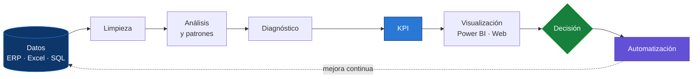

<!-- ═══════════════════════════ ENCABEZADO ANIMADO ═══════════════════════════ -->
<p align="center">
  
</p>

<p align="center">
  <a href="https://github.com/Santiago131440">
    
  </a>
</p>

<p align="center">
  <a href="https://linkedin.com/in/santisterling"></a>
  <a href="mailto:santisterling@gmail.com"></a>
  
  
</p>

---

## Sobre mí

```python
class SantiagoSterling:
    rol         = "Analista de Producción y Datos · Desarrollador de Software"
    experiencia = "≈ 9 años en entornos industriales"
    formacion   = [
        "Tecnólogo en Análisis y Desarrollo de Software — SENA",
        "Tecnólogo en Gestión de la Producción Industrial — SENA",
        "Diplomado en Gerencia de Producción — SENA",
    ]
    sectores    = ["Bebidas", "Consumo masivo", "Empaques", "Farmacéutica", "Agroindustria"]
    enfoque     = "datos → limpieza → análisis → patrones → diagnóstico → KPI → visualización → decisión → automatización"
    objetivo    = "IA, automatización y BI aplicados a negocios y operaciones industriales"

    def diferencial(self):
        return "Conozco el piso de planta por dentro y lo traduzco a software y datos."
```

> No me quedo en describir cifras: busco **patrones, anomalías, causas y oportunidades**, y las convierto en recomendaciones que se pueden ejecutar.

---

## Cómo trabajo



---

## Mi enfoque

<table>
<tr>
<td width="50%" valign="top">

### Análisis de datos y BI
Visualización clara y orientada a decisiones.

- KPI de producción: cumplimiento, paradas, disponibilidad
- Dashboards ejecutivos en **Power BI** (DAX, modelado)
- **Excel avanzado**: Power Query, Power Pivot, VBA

</td>
<td width="50%" valign="top">

### Desarrollo de software
Sistemas pensados para escalar y mantenerse en el tiempo.

- Aplicaciones web full stack y APIs REST
- Integración con ERP y reportes
- Arquitectura limpia, código mantenible

</td>
</tr>
<tr>
<td width="50%" valign="top">

### Automatización e IA
IA aplicada a problemas reales.

- ETL y cargues automáticos de reportes
- Análisis predictivo con Scikit-learn
- Agentes integrados a sistemas existentes

</td>
<td width="50%" valign="top">

### Diseño y web
Interfaces premium, minimalistas y funcionales.

- Responsive, con modo claro y oscuro
- Glassmorphism y animaciones sutiles
- HTML, CSS y JavaScript vanilla, o un framework cuando el proyecto lo pide

</td>
</tr>
</table>

---

## Proyectos destacados

<details open>
<summary><b>Sistema de indicadores de producción</b> — Python · Power BI</summary>
<br/>

Consolida los planes semanales y los reportes del ERP en una sola base y calcula automáticamente:

- **% de cumplimiento al plan** y de producción
- **% de tiempo de paradas** y disponibilidad por centro de trabajo
- **Pareto** de centros y motivos de paro, con lectura automática del mes
- Tablas listas para **Power BI**, con medidas DAX documentadas

`Python` `openpyxl` `Tkinter` `Power BI` `DAX`
</details>

<details>
<summary><b>Quantix</b> — SaaS de inventarios para PYMEs</summary>
<br/>

Plataforma de gestión empresarial e inventarios pensada para pequeñas y medianas empresas: control de stock, movimientos y reportes.

`Full Stack` `SQL` `SaaS`
</details>

<details>
<summary><b>Sterling String</b> — marca de proyectos web interactivos</summary>
<br/>

Portafolios, dashboards, simuladores y juegos con estética premium, modo claro y oscuro, y animaciones fluidas.

`HTML` `CSS` `JavaScript`
</details>

---

## Stack tecnológico

<h4 align="center">Frontend</h4>
<p align="center">
  
</p>

<h4 align="center">Backend y bases de datos</h4>
<p align="center">
  
</p>

<h4 align="center">Cloud y DevOps</h4>
<p align="center">
  
</p>

<h4 align="center">Datos y Business Intelligence</h4>
<p align="center">
  
  
  
  
  
  
  
  <br/>
  
  
  
  
  
  
</p>

---

## Actividad en GitHub

<p align="center">
  
  
</p>

<p align="center">
  
</p>

<p align="center">
  
</p>

<p align="center">
  
</p>

<!-- Se activa con el workflow .github/workflows/snake.yml (ver instrucciones) -->
<p align="center">
  <picture>
    <source media="(prefers-color-scheme: dark)" srcset="https://raw.githubusercontent.com/Santiago131440/Santiago131440/output/github-snake-dark.svg"/>
    
  </picture>
</p>

---

## Objetivo actual

<p align="center">
  
</p>

| Ahora mismo | Aprendiendo | Abierto a |
|:---:|:---:|:---:|
| Indicadores de producción con Python + Power BI | IA aplicada y agentes | Trabajo remoto |
| Quantix (SaaS para PYMEs) | Machine Learning para operaciones | Colaboraciones en datos y software |
| Proyectos web de Sterling String | Arquitectura cloud | Productos digitales propios |

---

## Contacto

<p align="center">
  <a href="https://linkedin.com/in/santisterling"></a>
  <a href="mailto:santisterling@gmail.com"></a>
  <a href="https://github.com/Santiago131440"></a>
</p>

<!-- ═══════════════════════════ PIE ANIMADO ═══════════════════════════ -->
<p align="center">
  
</p>
